<picture>
  <source media="(prefers-color-scheme: dark)" srcset="https://raw.githubusercontent.com/suprio-dev/suprio-dev/main/dark.svg">
  <source media="(prefers-color-scheme: light)" srcset="https://raw.githubusercontent.com/suprio-dev/suprio-dev/main/light.svg">
  
</picture>

  

<picture>
  <source media="(prefers-color-scheme: dark)" srcset="https://readme-typing-svg.demolab.com?font=JetBrains+Mono&weight=600&size=20&duration=2500&pause=1000&color=22D3EE&center=true&vCenter=true&width=560&height=40&lines=%24+Hello%2C+I'm+Suprio+Adhikary;%24+Aspiring+MERN+Stack+Developer;%24+Currently+Learning+React;%24+Building.+Learning.+Shipping.">
  <source media="(prefers-color-scheme: light)" srcset="https://readme-typing-svg.demolab.com?font=JetBrains+Mono&weight=600&size=20&duration=2500&pause=1000&color=0369A1&center=true&vCenter=true&width=560&height=40&lines=%24+Hello%2C+I'm+Suprio+Adhikary;%24+Aspiring+MERN+Stack+Developer;%24+Currently+Learning+React;%24+Building.+Learning.+Shipping.">
  
</picture>

  

 

### Aspiring MERN Stack Developer · Future DevOps Engineer

*Build it. Automate it. Ship it.*

 

<a href="#console"><kbd>&nbsp;Console&nbsp;</kbd></a>
<a href="#stack"><kbd>&nbsp;Stack&nbsp;</kbd></a>
<a href="#skilltree"><kbd>&nbsp;Skill Tree&nbsp;</kbd></a>
<a href="#devops"><kbd>&nbsp;DevOps&nbsp;</kbd></a>
<a href="#workspace"><kbd>&nbsp;Workspace&nbsp;</kbd></a>
<a href="#stats"><kbd>&nbsp;Stats&nbsp;</kbd></a>
<a href="#connect"><kbd>&nbsp;Connect&nbsp;</kbd></a>

  

 

 

## Developer Console

**Hello, World! 👋**

I'm a computer science undergraduate who enjoys turning ideas into working projects and understanding how software works under the hood.

Currently, I'm learning **React** and strengthening my frontend development foundations. My next goal is to build full-stack applications with the MERN stack and gradually explore backend engineering and DevOps.

I believe in understanding the logic behind a feature rather than simply making it work.

 

 

## Technology Stack

 

 

## Skill Tree

 

 

## DevOps Path

<picture>
  <source media="(prefers-color-scheme: dark)" srcset="https://raw.githubusercontent.com/suprio-dev/suprio-dev/main/pipeline-dark.svg">
  <source media="(prefers-color-scheme: light)" srcset="https://raw.githubusercontent.com/suprio-dev/suprio-dev/main/pipeline-light.svg">
  
</picture>

 

**Upcoming Toolkit**

  

**Git Workflow, in Motion**

 

 

## Inside My Workspace

I enjoy building features step by step, experimenting with ideas, debugging my own code, and learning from what doesn't work.

**Think → Build → Debug → Improve → Ship**

 

**The Project Structure I'm Growing Towards**

 

 

## GitHub Contribution Log

 

 

 

 

## Let's Connect

<table width="85%">
<tr>
<td align="center">

### Open to Collaboration

I'm always interested in connecting with fellow developers, contributing to open source, learning from the community, and building meaningful projects together.

 

**Currently interested in**

`Open Source` &nbsp; `Collaboration` &nbsp; `Learning Together`

 

  

&nbsp;

&nbsp;

&nbsp;

&nbsp;

</td>
</tr>
</table>

 

<picture>
  <source media="(prefers-color-scheme: dark)" srcset="https://readme-typing-svg.demolab.com?font=JetBrains+Mono&weight=500&size=16&duration=3000&pause=1200&color=22D3EE&center=true&vCenter=true&width=520&height=30&lines=Learning+every+day.;Building+with+purpose.;Let's+build+something+together.">
  <source media="(prefers-color-scheme: light)" srcset="https://readme-typing-svg.demolab.com?font=JetBrains+Mono&weight=500&size=16&duration=3000&pause=1200&color=0369A1&center=true&vCenter=true&width=520&height=30&lines=Learning+every+day.;Building+with+purpose.;Let's+build+something+together.">
  
</picture>

 

