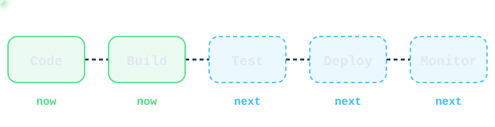

<div align="center">


<picture>
  <source media="(prefers-color-scheme: dark)" srcset="https://raw.githubusercontent.com/suprio-dev/suprio-dev/main/dark.svg">
  <source media="(prefers-color-scheme: light)" srcset="https://raw.githubusercontent.com/suprio-dev/suprio-dev/main/light.svg">
  
</picture>

<br>

<picture>
  <source media="(prefers-color-scheme: dark)" srcset="https://readme-typing-svg.demolab.com?font=JetBrains+Mono&weight=600&size=20&duration=2500&pause=1000&color=22D3EE&center=true&vCenter=true&width=560&height=40&lines=%24+Hello%2C+I'm+Suprio+Adhikary;%24+Aspiring+MERN+Stack+Developer;%24+Currently+Learning+React;%24+Building.+Learning.+Shipping.">
  <source media="(prefers-color-scheme: light)" srcset="https://readme-typing-svg.demolab.com?font=JetBrains+Mono&weight=600&size=20&duration=2500&pause=1000&color=0369A1&center=true&vCenter=true&width=560&height=40&lines=%24+Hello%2C+I'm+Suprio+Adhikary;%24+Aspiring+MERN+Stack+Developer;%24+Currently+Learning+React;%24+Building.+Learning.+Shipping.">
  
</picture>

<br>


<br><br>

<a href="https://github.com/suprio-dev"></a>
&nbsp;
<a href="https://www.linkedin.com/in/suprio-adhikary-7a0a263b0"></a>
&nbsp;
<a href="mailto:suprioadhikary802@gmail.com"></a>

<br><br>

### Aspiring MERN Stack Developer · Future DevOps Engineer

*Build it. Automate it. Ship it.*

<br>


<br><br>

<a href="#console"><kbd>&nbsp;Console&nbsp;</kbd></a>
<a href="#stack"><kbd>&nbsp;Stack&nbsp;</kbd></a>
<a href="#skilltree"><kbd>&nbsp;Skill Tree&nbsp;</kbd></a>
<a href="#devops"><kbd>&nbsp;DevOps&nbsp;</kbd></a>
<a href="#workspace"><kbd>&nbsp;Workspace&nbsp;</kbd></a>
<a href="#stats"><kbd>&nbsp;Stats&nbsp;</kbd></a>
<a href="#connect"><kbd>&nbsp;Connect&nbsp;</kbd></a>

<br><br>


<br>


</div>

<br>

<a id="console"></a>

## Developer Console

<div align="center">

<table width="85%">
<tr>
<td>

```yaml
name: Suprio Adhikary
location: Kolkata, India
education: B.Tech CSE
current_focus: React
building_towards: MERN Stack
long_term_goal: DevOps Engineering
mindset: Understand deeply. Build consistently.
```

</td>
</tr>
</table>

**Hello, World! 👋**

I'm a computer science undergraduate who enjoys turning ideas into working projects and understanding how software works under the hood.

Currently, I'm learning **React** and strengthening my frontend development foundations. My next goal is to build full-stack applications with the MERN stack and gradually explore backend engineering and DevOps.

I believe in understanding the logic behind a feature rather than simply making it work.

<br>

<kbd> Learning </kbd> &nbsp; React  
<kbd> Building </kbd> &nbsp; MERN Stack  
<kbd> Exploring </kbd> &nbsp; Backend & DevOps

</div>

<br>


<br>

<a id="stack"></a>

## Technology Stack

<div align="center">

**Frontend Development**


<br>

**Backend & Databases**


<br>

**Programming Languages**


<br>

**Tools & Workflow**


<br>

**AI-Assisted Development**


</div>

<br>


<br>

<a id="skilltree"></a>

## Skill Tree

<div align="center">


</div>

<br>


<br>

<a id="devops"></a>

## DevOps Path

<div align="center">

<picture>
  <source media="(prefers-color-scheme: dark)" srcset="https://raw.githubusercontent.com/suprio-dev/suprio-dev/main/pipeline-dark.svg">
  <source media="(prefers-color-scheme: light)" srcset="https://raw.githubusercontent.com/suprio-dev/suprio-dev/main/pipeline-light.svg">
  
</picture>

<br><br>

<table width="85%">
<tr>
<td align="center" width="33%">

**01 · NOW**

MERN Stack

Git & GitHub

</td>
<td align="center" width="33%">

**02 · NEXT**

Linux

Docker · CI/CD

</td>
<td align="center" width="33%">

**03 · LATER**

Cloud

Kubernetes · Monitoring

</td>
</tr>
</table>

<br>

**Upcoming Toolkit**


<br><br>

**Git Workflow, in Motion**



</div>

<br>


<br>

<a id="workspace"></a>

## Inside My Workspace

<div align="center">

<table width="85%">
<tr>
<td align="center" width="50%">

### ⚙️ Development Workflow

<br>

```javascript
const workflow = [
  "Understand the problem",
  "Break it into steps",
  "Build the core logic",
  "Test and debug",
  "Refine and ship"
];
```

</td>
<td align="center" width="50%">

### ⌘ Git Workflow

<br>

```bash
git status
git add .
git commit -m "feat: add functionality"
git push origin main
```

</td>
</tr>
</table>

<br>

I enjoy building features step by step, experimenting with ideas, debugging my own code, and learning from what doesn't work.

**Think → Build → Debug → Improve → Ship**

<br><br>

**The Project Structure I'm Growing Towards**



</div>

<br>


<br>

<a id="stats"></a>

## GitHub Contribution Log

<div align="center">

### Contribution Streak

<table width="85%">
<tr>
<td align="center">

<picture>
  <source media="(prefers-color-scheme: dark)" srcset="https://streak-stats.demolab.com/?user=suprio-dev&hide_border=true&background=080D1A&ring=22D3EE&fire=67E8F9&currStreakNum=E2E8F0&sideNums=E2E8F0&currStreakLabel=22D3EE&sideLabels=22D3EE&dates=94A3B8">
  <source media="(prefers-color-scheme: light)" srcset="https://streak-stats.demolab.com/?user=suprio-dev&hide_border=true&background=F5F9FC&ring=0891B2&fire=0891B2&currStreakNum=1E293B&sideNums=1E293B&currStreakLabel=0369A1&sideLabels=0369A1&dates=64748B">
  
</picture>

</td>
</tr>
</table>

<br>

### GitHub Overview

<table width="85%">
<tr>
<td align="center" width="50%">

<picture>
  <source media="(prefers-color-scheme: dark)" srcset="https://github-readme-stats-mu-dusky-69.vercel.app/api?username=suprio-dev&show_icons=true&hide_rank=true&hide_border=true&border_radius=12&bg_color=080D1A&title_color=22D3EE&text_color=E2E8F0&icon_color=67E8F9&include_all_commits=true">
  <source media="(prefers-color-scheme: light)" srcset="https://github-readme-stats-mu-dusky-69.vercel.app/api?username=suprio-dev&show_icons=true&hide_rank=true&hide_border=true&border_radius=12&bg_color=F5F9FC&title_color=0369A1&text_color=1E293B&icon_color=0F766E&include_all_commits=true">
  
</picture>

</td>
<td align="center" width="50%">

<picture>
  <source media="(prefers-color-scheme: dark)" srcset="https://github-readme-stats-mu-dusky-69.vercel.app/api/top-langs/?username=suprio-dev&layout=compact&hide_border=true&border_radius=12&bg_color=080D1A&title_color=22D3EE&text_color=E2E8F0&langs_count=5">
  <source media="(prefers-color-scheme: light)" srcset="https://github-readme-stats-mu-dusky-69.vercel.app/api/top-langs/?username=suprio-dev&layout=compact&hide_border=true&border_radius=12&bg_color=F5F9FC&title_color=0369A1&text_color=1E293B&langs_count=5">
  
</picture>

</td>
</tr>
</table>

<br>

### Activity Graph

<picture>
  <source media="(prefers-color-scheme: dark)" srcset="https://github-readme-activity-graph.vercel.app/graph?username=suprio-dev&bg_color=080D1A&color=22D3EE&line=22D3EE&point=E2E8F0&area=true&area_color=22D3EE&hide_border=true&radius=12&hide_title=true">
  <source media="(prefers-color-scheme: light)" srcset="https://github-readme-activity-graph.vercel.app/graph?username=suprio-dev&bg_color=F5F9FC&color=0369A1&line=0891B2&point=1E293B&area=true&area_color=0891B2&hide_border=true&radius=12&hide_title=true">
  
</picture>

<br><br>

### Trophy Case


<br><br>

### Contribution Snake


</div>

<br>


<br>

<a id="philosophy"></a>

## Developer Philosophy

<div align="center">

<table width="85%">
<tr>
<td align="center">

**01 · Understand Before Implementing**

Learn the logic instead of relying on copy-paste.

</td>
</tr>
<tr>
<td align="center">

**02 · Consistency Over Perfection**

Small, meaningful progress compounds over time.

</td>
</tr>
<tr>
<td align="center">

**03 · Build to Learn**

Every project sharpens problem-solving skills.

</td>
</tr>
<tr>
<td align="center">

**04 · Automate the Boring Parts**

If I do it twice, I'll script it.

</td>
</tr>
</table>

</div>

<br>


<br>

<a id="connect"></a>

## Let's Connect

<div align="center">

<table width="85%">
<tr>
<td align="center">

### Open to Collaboration

I'm always interested in connecting with fellow developers, contributing to open source, learning from the community, and building meaningful projects together.

<br>

**Currently interested in**

`Open Source` &nbsp; `Collaboration` &nbsp; `Learning Together`

<br>

<a href="mailto:suprioadhikary802@gmail.com">

</a>

<br><br>

<a href="https://github.com/suprio-dev"></a>
&nbsp;
<a href="https://www.linkedin.com/in/suprio-adhikary-7a0a263b0"></a>
&nbsp;
<a href="https://www.instagram.com/suprioadhikary_07"></a>
&nbsp;
<a href="https://x.com/suprio_a84633"></a>

</td>
</tr>
</table>

<br>

<picture>
  <source media="(prefers-color-scheme: dark)" srcset="https://readme-typing-svg.demolab.com?font=JetBrains+Mono&weight=500&size=16&duration=3000&pause=1200&color=22D3EE&center=true&vCenter=true&width=520&height=30&lines=Learning+every+day.;Building+with+purpose.;Let's+build+something+together.">
  <source media="(prefers-color-scheme: light)" srcset="https://readme-typing-svg.demolab.com?font=JetBrains+Mono&weight=500&size=16&duration=3000&pause=1200&color=0369A1&center=true&vCenter=true&width=520&height=30&lines=Learning+every+day.;Building+with+purpose.;Let's+build+something+together.">
  
</picture>

<br>


</div>
